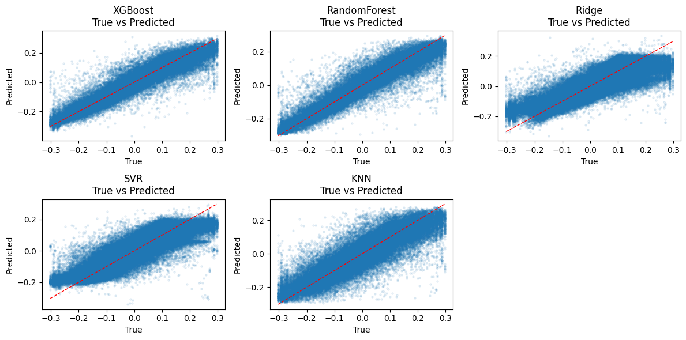

# From Simulation to Strategy: Predicting Racing Tire Degradation

**Georgia Tech M.S. Analytics Practicum, 2025**
Carlos I. Santa

[📄 Full Report (PDF)](./practicum_final_submission.pdf)

---

## Overview

Tire wear drives a lot of race strategy, but you can't measure it directly. No sensor reports how much grip a tire has left. I wanted to see whether I could estimate it from telemetry instead.

I recorded about 225 minutes of 360Hz telemetry driving a Porsche 911 GT3 Cup at Laguna Seca in iRacing, then:

- **Built the degradation label myself.** Telemetry has no ground-truth wear measurement, so I combined four physics-based components (frictional power, asymmetric load, thermal aging and transient heat spikes). I checked each one against the literature and calibrated it with controlled test sessions.
- **Found and fixed data leakage.** My first validation scores were too good, because laps from the same session ended up in both training and test sets. I switched to leave-one-session-out cross-validation, so every test is on a session the model has never seen.
- **Compared five model families:** Random Forest, XGBoost, Ridge, SVR and KNN. Random Forest scored slightly higher, but XGBoost trained about 450 times faster, and speed matters if this is ever going to run in real time. I chose XGBoost.
- **Used SHAP to turn the model into feedback a driver can use.** SHAP shows which inputs (braking, throttle lift, lateral G) are driving wear at a given moment, not just on average.

**Final model: XGBoost, R² = 0.92 on a fully held-out session.**

---

## Why I built it this way

Most tire models in the literature are physics simulations, like Pacejka's Magic Formula and its variants. They need inputs that are hard to measure in real time, and they don't tie wear back to what the driver is doing. I wanted to know whether wear could be learned straight from telemetry, fast enough and clearly enough to give feedback to a driver during a session. This proof of concept suggests it can.

---

## Key Results

| Model | R² (mean, CV) | MAE | RMSE | MAPE | Avg. Train Time |
|---|---|---|---|---|---|
| Random Forest | 0.888 | 0.024 | 0.038 | 1.53 | 100.2s |
| **XGBoost** | 0.880 | 0.026 | 0.039 | 1.71 | **0.22s** |
| KNN | 0.787 | 0.036 | 0.052 | 2.32 | 0.01s |
| Ridge | 0.661 | 0.050 | 0.066 | 4.06 | 0.02s |
| SVR | 0.676 | 0.052 | 0.064 | 5.32 | 108.2s |

The tuned XGBoost model on a fully unseen test session: **R² = 0.92, MAE = 0.024, MAPE = 1.65%**

<p align="center">
  
</p>

### What drives degradation

In the high-wear moments, SHAP keeps pointing to the same three things: heavy braking, a drop in lateral G (a sign the tires are losing grip in corners) and abrupt throttle lifts. That gives a driver or engineer something specific to work on, instead of a single wear number.

<p align="center">
  
  &nbsp;&nbsp;
  
</p>

<p align="center">
  
</p>

---

## Repo Structure

```
├── practicum_final_submission.pdf   # Full write-up: methodology, label design, EDA, results, limitations
├── notebooks/
│   ├── 01_eda.ipynb                 # Signal validation, degradation-label EDA, feature correlations
│   ├── 02_model_build.ipynb         # Feature engineering and first-pass training across 5 model families
│   ├── 03_driver_feedback_poc.ipynb # SHAP interpretability layer and driver feedback tool
│   └── 04_final_model_tuning.ipynb  # LOSO-CV, hyperparameter tuning, final model selection and evaluation
├── data/
│   └── sample_stint.csv             # One cleaned driving stint for reference (see below)
└── assets/                          # Figures used in this README
```

## About the data

iRacing saves telemetry in its own `.ibt` format: 360Hz across 270 channels, with no clean way to export it to CSV. Getting it model-ready took a lot of custom parsing and cleanup, including downsampling to 12Hz, filtering anomalies and correcting for slope and elevation. The report covers all of it.

The full session files are about 1GB each (10 sessions) and specific to this car, track and setup, so they aren't in the repo. `data/sample_stint.csv` is one cleaned stint, so you can run the notebooks end to end without rebuilding the telemetry pipeline.

## Limitations

This is a proof of concept, not a general tire model. It's fit to one driver, one car, one track and one setup, and the degradation label is a physics-based estimate, not a real wear measurement. Section 10 of the report covers this in more depth, including confounders like the car getting lighter as fuel burns off and the driver improving over a session. It also describes what a next version would need: more drivers, cars and tracks, a low-latency real-time pipeline, and a second look at the label design.

## Tech Stack

Python · pandas · scikit-learn · XGBoost · SHAP · matplotlib/seaborn

---

*Built for the M.S. Analytics program at Georgia Tech. Questions or feedback are welcome, so feel free to open an issue.*
