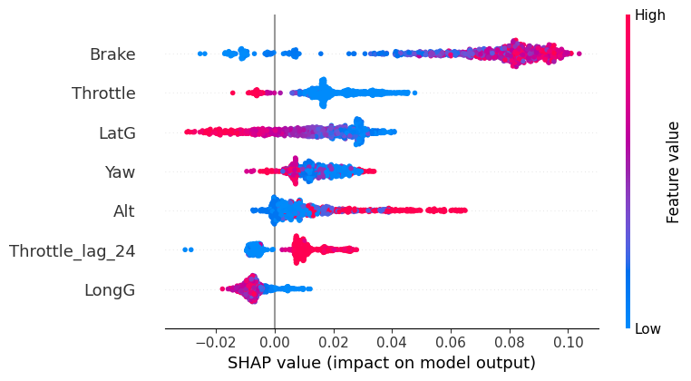
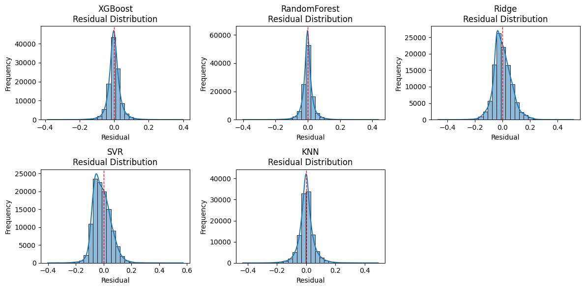
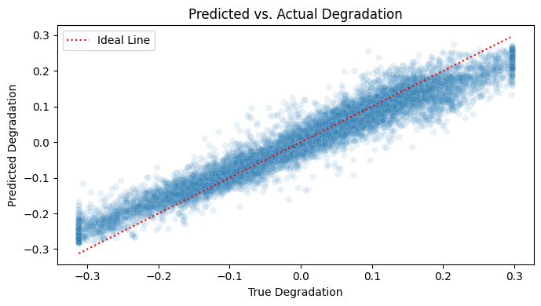

# From Simulation to Strategy: Predicting Racing Tire Degradation

**Georgia Tech M.S. Analytics — Practicum, 2025**
Carlos I. Santa

[📄 Full Report (PDF)](./Practicum_Final_Submission.pdf)

---

## Overview

Tire degradation is one of the most consequential — and least observable — variables in motorsport strategy. There's no sensor that outputs "% grip remaining." This project builds one from telemetry alone.

Using ~225 minutes of 360Hz telemetry recorded from a Porsche 911 GT3 Cup at Laguna Seca (iRacing), I:

- **Engineered a composite degradation label from first principles** — no ground-truth wear measurement exists in racing telemetry, so I built one from four physics-grounded components (frictional power, asymmetric load, thermal aging, transient heat spikes), each independently validated against literature and calibrated through controlled test sessions.
- **Diagnosed and fixed a data leakage problem** that was inflating validation performance, by building a session-level "Leave-One-Session-Out" cross-validation scheme.
- **Trained and compared 5 model families** (Random Forest, XGBoost, Ridge, SVR, KNN), then chose XGBoost over the marginally higher-performing Random Forest for a 450x speed advantage — a deliberate accuracy/latency tradeoff aimed at real-time deployment.
- **Used SHAP to turn the model into a coaching tool**, surfacing which specific driver inputs (braking, throttle lift, lateral G) drive degradation moment-to-moment, not just in aggregate.

**Final model: XGBoost, R² = 0.92 on a fully held-out session.**

---

## Why this matters

Most tire models in the literature are physics-simulation-based (Pacejka's Magic Formula and its derivatives) and require inputs that are impractical to measure in real time, and they don't directly connect wear to *driver behavior*. This project takes a different angle: can degradation be learned directly from telemetry in a way that's fast enough and interpretable enough to hand back to a driver mid-session? The proof-of-concept says yes.

---

## Key Results

| Model | R² (mean, CV) | MAE | RMSE | MAPE | Avg. Train Time |
|---|---|---|---|---|---|
| Random Forest | 0.888 | 0.024 | 0.038 | 1.53 | 100.2s |
| **XGBoost** | 0.880 | 0.026 | 0.039 | 1.71 | **0.22s** |
| KNN | 0.787 | 0.036 | 0.052 | 2.32 | 0.01s |
| Ridge | 0.661 | 0.050 | 0.066 | 4.06 | 0.02s |
| SVR | 0.676 | 0.052 | 0.064 | 5.32 | 108.2s |

Final tuned XGBoost model on a fully unseen test session: **R² = 0.92, MAE = 0.024, MAPE = 1.65%**

<p align="center">
  
</p>

### What actually drives degradation

SHAP analysis on high-degradation moments consistently surfaces heavy braking, dropping lateral G (a symptom of grip loss under cornering), and abrupt throttle lift as the dominant contributors — turning the model from a black box into a diagnostic tool a driver or engineer could actually act on.

<p align="center">
  
  &nbsp;&nbsp;
  
</p>

<p align="center">
  
</p>

---

## Repo Structure

```
├── practicum_final_submission.pdf   # Full write-up: methodology, label design, EDA, results, limitations
├── notebooks/
│   ├── 01_eda.ipynb                 # Signal validation, degradation-label EDA, feature correlation analysis
│   ├── 02_model_build.ipynb 		 # Feature engineering + first-pass model training across 5 model families
│   ├── 03_driver_feedback_poc.ipynb # SHAP-based interpretability layer / driver feedback tool
│   └── 04_final_model_tuning.ipynb  # LOSO-CV, hyperparameter tuning, final model selection & evaluation
├── data/
│   └── sample_stint.csv             # One sample driving stint (post-cleanup) for reference — see note below
└── assets/                          # Figures used in this README
```

## A note on the data

Raw telemetry is recorded by iRacing in a proprietary `.ibt` format at 360Hz across 270 channels — there's no clean export path to a usable CSV, so getting from raw recording to model-ready data required a fair amount of custom parsing and cleanup (downsampling to 12Hz, anomaly filtering, slope/elevation correction, etc.), all of which is detailed in the report.

Full session files are large (~1GB each, 10 sessions) and specific to this car/track/setup combination, so they aren't included here. Instead, `data/sample_stint.csv` includes one cleaned single-stint file so the notebooks can be run and inspected end-to-end without needing to reproduce the original telemetry pipeline.

## Limitations

This is explicitly a proof of concept, not a generalized tire model. It's fit to one driver, one car, one track, and one setup, and the degradation label itself is a physics-informed proxy rather than a ground-truth measurement. The full report (Section 10) goes into more depth on this, along with confounders like fuel-burn weight loss and driver learning curve across a session, and what a next iteration would need (multiple drivers, cars, and tracks; a low-latency real-time pipeline; a revisited label design).

## Tech Stack

Python · pandas · scikit-learn · XGBoost · SHAP · matplotlib/seaborn

---

*Built as part of the M.S. Analytics program at Georgia Tech. Questions or feedback welcome — feel free to open an issue.*
